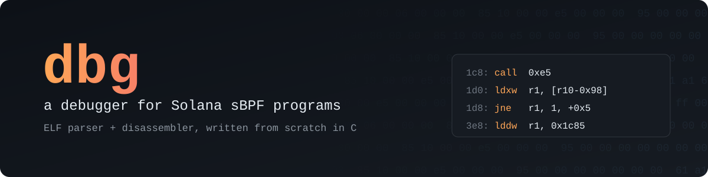
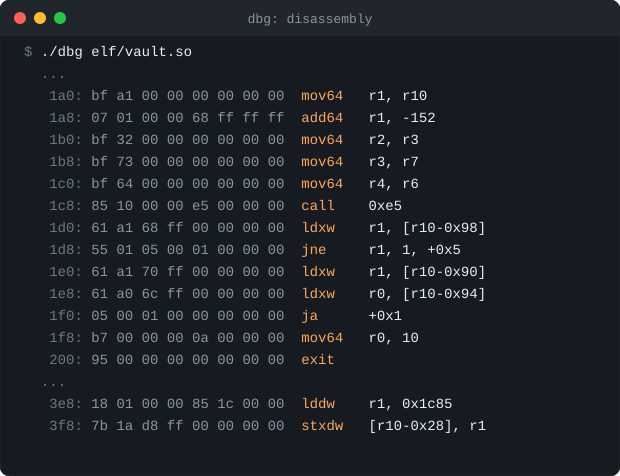
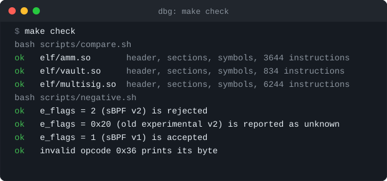

  

  
  
  
  

**dbg** reads a compiled Solana program (`.so`) and takes it apart: the ELF
header, every section, the symbol table, and every sBPF instruction. It is
written from scratch in C, with no libraries beyond libc, as a way to learn
how Solana programs look at the byte level.

The goal is a source-level debugger: show the Rust line a program failed on,
and how many compute units each line cost. Today it is an ELF reader and a
disassembler whose output matches Solana's own `llvm-objdump`, instruction
for instruction.

  

## Status

- [x] ELF header: parsed and validated (class, endianness, `EM_SBPF`, bounds)
- [x] Section table and section names (`.shstrtab`)
- [x] Symbol table: function names, addresses, sizes
- [x] Disassembler: every sBPF v0/v1 opcode, including two-slot `lddw`
- [ ] Readable calls: function names and syscall names (via `.rel.dyn`)
- [ ] Source mapping: instruction → Rust `file:line` (`.debug_line`)
- [ ] VM: run a program, find the failing instruction, count CU per line
- [ ] TUI: source view with the failing line, CU per line, assembly underneath

sBPF v2 and later are rejected with a clear error for now: v2 moved loads
and stores to other opcodes, so v0 decoding would print wrong instructions.

Built and tested on Arch Linux (`Linux 7.2.3-arch1-3`).

`make check` compares every instruction with Solana's `llvm-objdump`:

  

## References

- [sBPF bytecode spec](https://github.com/anza-xyz/sbpf/blob/main/doc/bytecode.md):
  instruction layout, every opcode, version differences
- [solana-sbpf](https://github.com/anza-xyz/sbpf): the VM and loader the
  validator uses (`ebpf.rs`, `elf.rs`, `disassembler.rs`)
- `man 5 elf` and `/usr/include/elf.h`: the ELF format

## License

[MIT](LICENSE)
